# Setting up AI in Study Coach: a step-by-step guide

This guide is for everyone, including people who have never done anything like this before.
Take it slowly. Every step has a picture. **The first part takes about 3 minutes and is free.**

> **Do I need this at all?** No. Flashcards, quizzes, your study plan and your progress all work
> without AI. AI adds extras: a tutor you can chat with, quizzes written for you, and feedback
> when you explain something in your own words.

---

## First, two words you will see

**AI service.** A company that runs the AI, like OpenRouter or Claude. Study Coach talks to it for you.

**Key** (or "API key"). A long secret code, like a password, that lets Study Coach use *your* account
on that AI service. It looks something like `sk-or-v1-8f2c…` (much longer). You copy it from the
service's website and paste it into Study Coach. That's all you do with it.

**Study Coach doesn't come with any AI account or key.** You use your own, so you are always in control:
nobody else can run up costs on your account, and you can switch AI off any time.

> 🔒 **Keep your key secret**, like a password. Don't post it online or send it to anyone.
> Study Coach keeps it only on your computer.

---

## Where to find "Set up AI"

Open Study Coach. In the menu on the left, click **Settings**, then **Set up AI**.

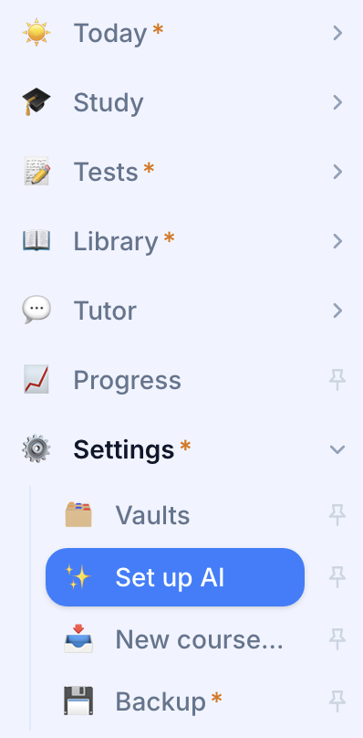

If you have just installed Study Coach and haven't added a course yet, there is also a
**set up AI** link on the welcome screen:

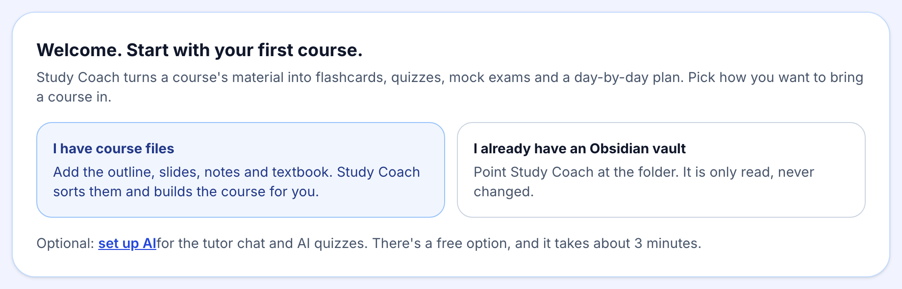

You will see this page. Each numbered box is one AI service. **You only need box 1.** The others are extras.

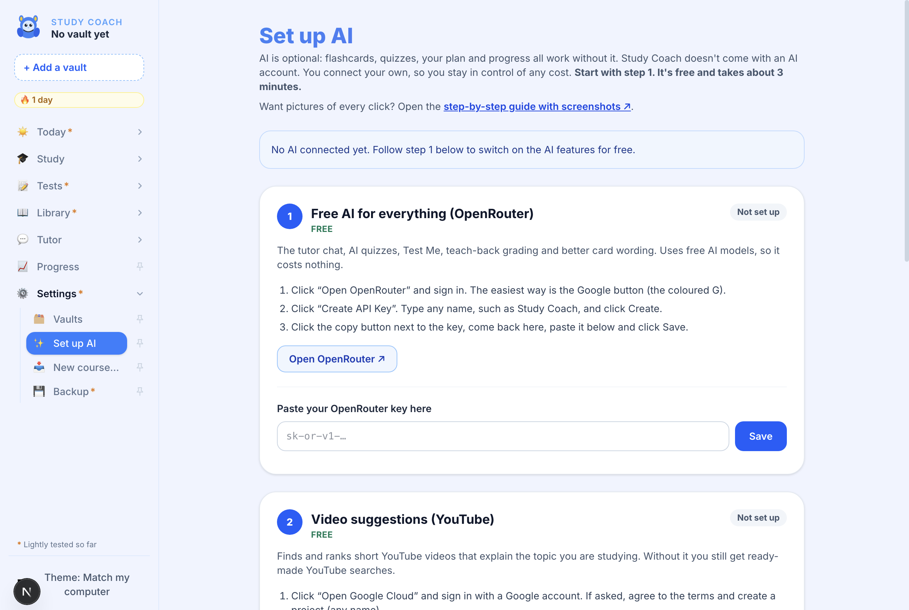

| Box | What it gives you | Cost |
|---|---|---|
| **1. OpenRouter** | The tutor chat, AI quizzes, Test Me, feedback on your explanations | **Free** |
| 2. YouTube | Short videos that explain what you're studying | Free |
| 3. Claude | The most careful AI answers (optional upgrade) | Paid, about $5 to start |
| 4. Ollama | AI that works without the internet | Free |

---

## Step 1: Free AI with OpenRouter (do this one)

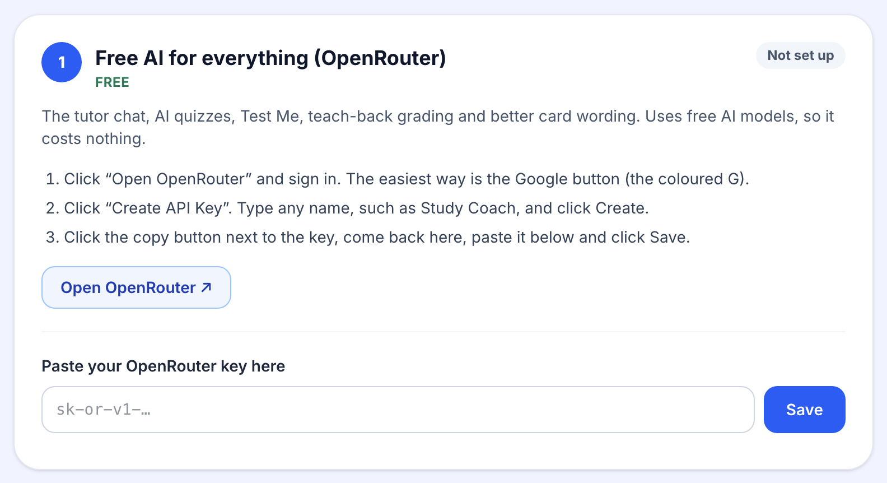

**1. Click the "Open OpenRouter" button.** The OpenRouter website opens in your web browser.

**2. Sign in.** You will see this box. The easiest way is to click the **Google button**
(the coloured **G** in the middle) and choose your Google account. No Google account? Type your
email address and click **Continue** instead, then follow the email they send you.

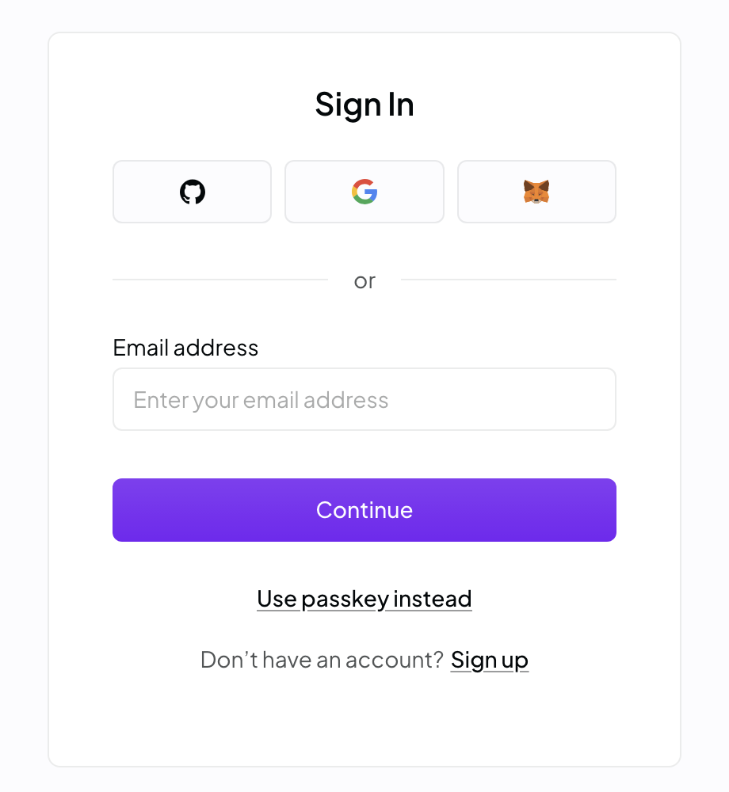

**3. Make your key.** After signing in you land on the **API Keys** page. Click **Create API Key**
(sometimes just **Create**). Where it asks for a name, type `Study Coach`, then click **Create**.

**4. Copy the key.** Your new key appears once. Click the **copy button** next to it (it looks like
two overlapping squares). Copying with the button avoids missing any letters.

> ⚠️ OpenRouter shows the key only once. If you close the window before copying it, no problem:
> delete that key and create a new one.

**5. Go back to Study Coach** and click inside the box under **"Paste your OpenRouter key here"**.
Paste the key: on a Mac press **⌘ Command + V**, on Windows press **Ctrl + V**. You will see dots
instead of letters. That's normal; it hides your key like a password.

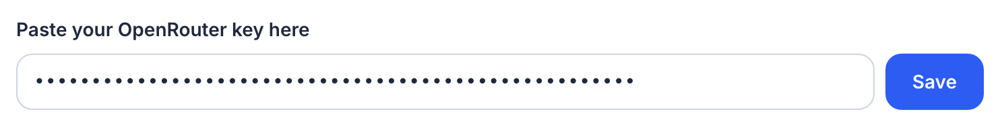

**6. Click Save.** Study Coach checks the key with OpenRouter, which takes a few seconds.

- If it works, you will see **"It works!"**. Study Coach restarts by itself to switch the AI on,
  and the page reloads after a few seconds.
- The box at the top now says **"AI is ready to use"**, and step 1 shows **✓ Connected** with
  the last four characters of your key:

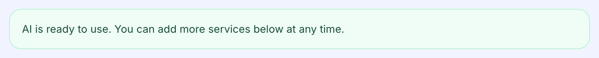

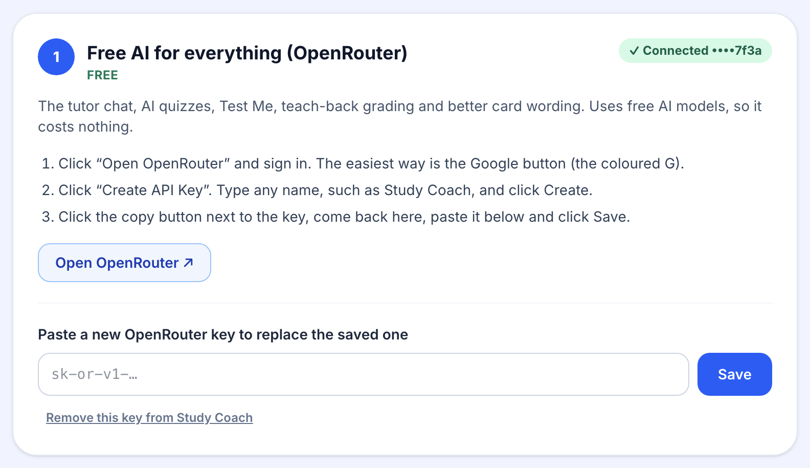

🎉 **That's it. AI is on.** Try it: open **Tutor** in the menu and ask a question about your course.

**If something went wrong**, Study Coach tells you in a red box what to fix. For example, if you
pasted a key from a different website:

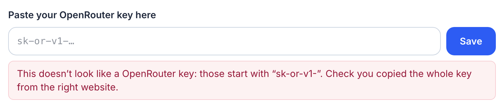

Copy the key again with the copy button on OpenRouter, paste it, and click **Save** again.
More help is in [Something isn't working](#something-isnt-working) below.

> 💡 **About "free":** OpenRouter's free AI models cost nothing, but they have a daily limit on
> how many questions you can ask. If the AI stops answering late in the day, try again tomorrow.
> You never pay anything unless you choose to add credit on OpenRouter yourself.

---

## Step 2 (optional): Video suggestions with YouTube

Study Coach can find short YouTube videos that explain the topic you are studying. Without this
key you still get ready-made YouTube searches, so this step is a nice extra, not a must.

This one has more clicks because it goes through Google's developer website. Allow about 10 minutes.
It is free, and Google does not ask for a credit card for this.

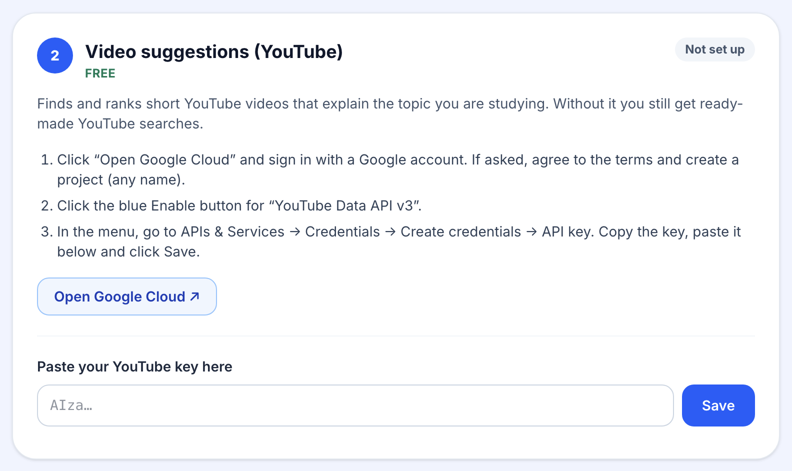

1. Click **Open Google Cloud** and sign in with your Google account.
2. The first time, Google asks you to **agree to its terms**. Tick the box and continue.
3. Google may ask you to **create a project** (a folder for your settings). Click **Create project**,
   keep the suggested name or type `Study Coach`, and click **Create**. Wait a few seconds.
4. You should now see **YouTube Data API v3**. Click the blue **Enable** button.
   (If you don't see it, click **Open Google Cloud** in Study Coach again.)
5. Open the menu with the **☰** button at the top left, then go to **APIs & Services → Credentials**.
6. Click **+ Create credentials** at the top, then **API key**.
7. A box shows your new key (it starts with `AIza`). Click the **copy button**.
8. Back in Study Coach, paste it into the box in step 2 and click **Save**.

If Study Coach says the YouTube service isn't switched on yet, go back to step 4 above, click
**Enable**, wait a minute, and try again.

---

## Step 3 (optional, paid): Best quality with Claude

Claude is an AI made by Anthropic. It gives the most careful tutor answers and feedback.
**It costs money**: you buy credit in advance (the smallest amount is about $5, which goes a long
way for studying). Once a Claude key is saved, Study Coach uses Claude instead of the free models.

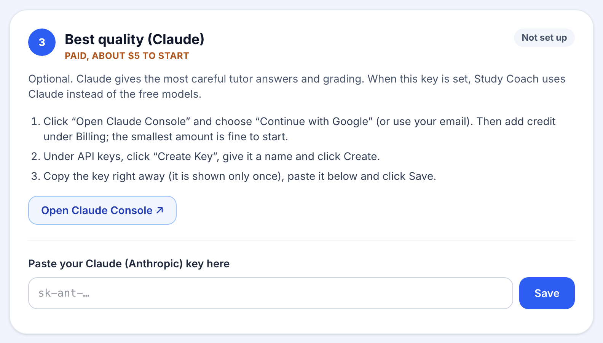

1. Click **Open Claude Console**. Sign in with **Continue with Google**, or type your email and
   click **Continue with email**.

   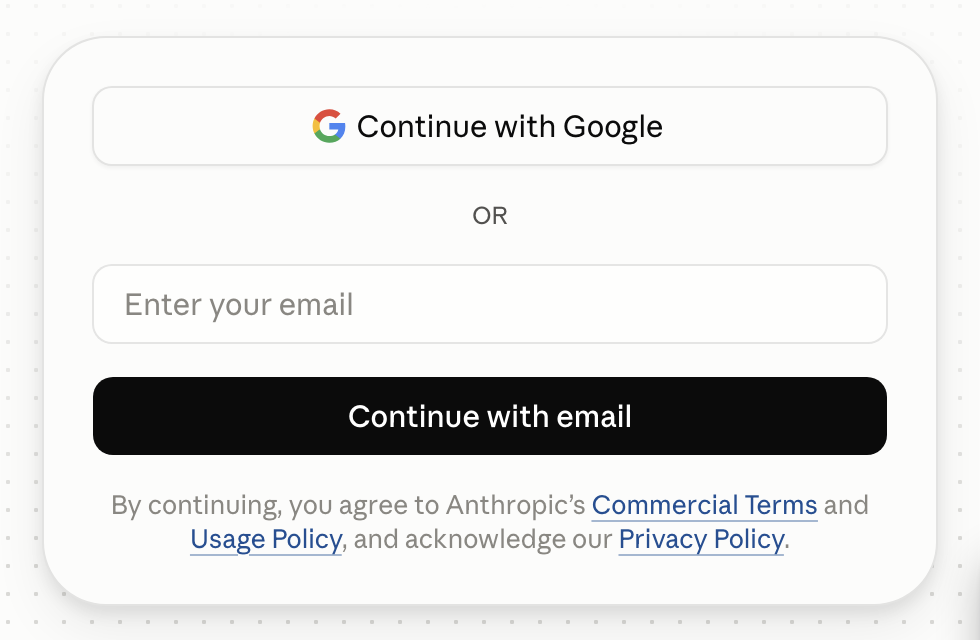

2. Add credit: in the Claude Console, open **Billing**, click to buy credits, and follow the steps.
   This is a normal online payment on Anthropic's website. Study Coach never sees your card.
3. Open **API keys** and click **Create Key**. Type `Study Coach` as the name and click **Create**.
4. **Copy the key right away.** It starts with `sk-ant-` and is shown only once.
5. Back in Study Coach, paste it into the box in step 3 and click **Save**.

> 💡 To keep spending in check, the Claude Console lets you set a monthly spending limit for your account.

---

## Step 4 (optional): AI without the internet, with Ollama

Ollama runs a small AI **on your own computer**, so it works offline and nothing you type leaves
your machine. It's free and needs no key. It is slower and simpler than the online options, and
it needs a fairly recent computer and about 3 GB of free space.

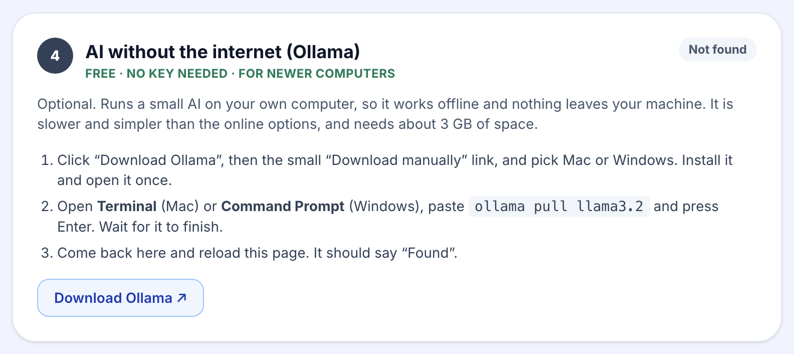

1. Click **Download Ollama**. On the Ollama website, **don't copy the line of code**. Instead,
   click the small **Download manually** link under it, then choose **macOS** or **Windows**.

   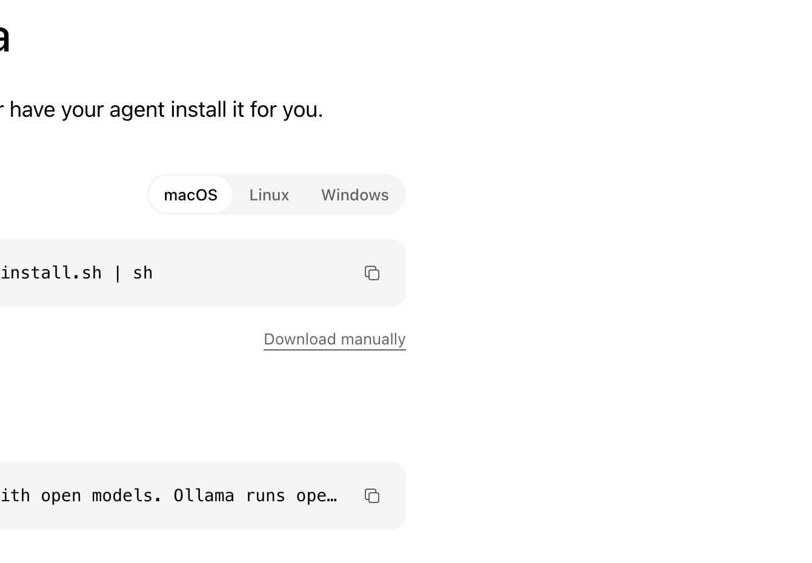

2. Open the file you downloaded and install Ollama like any other app. Open it once.
3. Now download the small AI model. This needs one typed command:
   - **Mac:** press **⌘ Command + Space**, type `Terminal`, and press **Enter**.
   - **Windows:** click **Start**, type `Command Prompt`, and press **Enter**.

   In the window that opens, paste this line and press **Enter**:

   ```
   ollama pull llama3.2
   ```

   Wait until it finishes (a few minutes; it shows a progress bar). Then you can close that window.
4. In Study Coach, reload the Set up AI page. Step 4 should now say **✓ Found**.

---

## Something isn't working

**"This doesn't look like a … key"**
You pasted something that isn't a key from that website, or only part of it. Go back to the
website, use its **copy button**, and paste again. Make sure you paste into the right box:
OpenRouter keys start with `sk-or-v1-`, YouTube keys with `AIza`, Claude keys with `sk-ant-`.

**"The provider says this key is not valid"**
The key may have been deleted, or a letter was missed. Create a new key on the website and paste that.

**"Could not reach the provider…"**
Your internet may be off. The key was saved anyway and will be used once you are back online.

**The AI stopped answering**
If you use the free OpenRouter models, you may have reached today's limit; try again tomorrow.
If you use Claude, check that your Claude Console account still has credit.

**I want to remove a key**
On the Set up AI page, click **Remove this key from Study Coach** under that service. To delete
the key for good, also delete it on the service's website.

**Is my key safe?**
Your key is stored only on your computer, in Study Coach's own settings file, and is sent only to
the service it belongs to. Study Coach shows only the last four characters of a saved key.

---

<details>
<summary>For the technically curious: where the keys are stored</summary>

The Set up AI page writes plain `KEY=value` lines to a settings file that only your user account can read:

- **Mac:** `~/Library/Application Support/Study Coach/settings.env`
- **Windows:** `%APPDATA%\Study Coach\settings.env`
- **Running from source:** `.env.local` in the project folder

The desktop app restarts its engine automatically when that file changes. The settings it understands
are listed in [`.env.example`](../../.env.example). In Docker, put keys in `.env.local` next to
`docker-compose.yml` instead.

</details>
